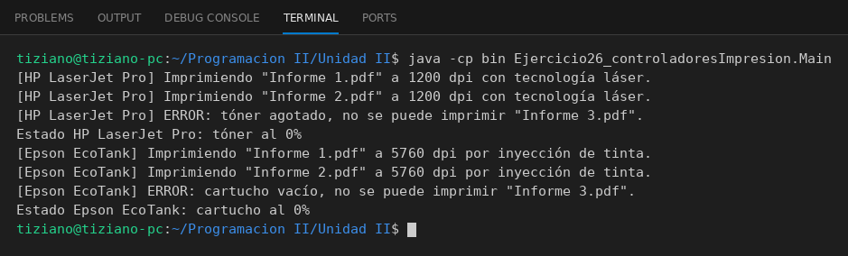

# Impresor

Programación II - Unidad 2 - Ejercicio 26

## Consigna
Una jerarquía de impresoras con un contrato común de impresión y validación de consumibles.

## Lógica
- Clase abstracta `Impresor` con `modelo`, `resolucion` y los métodos abstractos `imprimirDocumento` y `mostrarEstado`.
- `ImpresoraLaser` (nivel de tóner) e `ImpresoraTinta` (nivel de cartucho) extienden la clase y consumen recursos en cada impresión.
- Si el consumible se agota la impresión falla con un mensaje de error.
- `Main`: un arreglo de `Impresor` recorrido polimórficamente hasta agotar los consumibles.

## Ejecución

